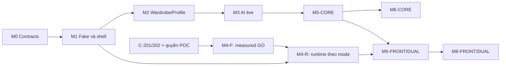

# Dependencies, milestones và trách nhiệm tích hợp

[Workflow](../../TEAM_WORKFLOW.md) · [Board](TASK_BOARD.md) · [Contracts](CONTRACTS.md) · [Runbook](RUNBOOK.md) · [VTO gate](VTO_FEASIBILITY.md)

Card là nguồn dependency cứng: prerequisite cần đạt để nghiệm thu task kế tiếp. Fixture/design có thể chuẩn bị sớm nhưng không đánh DONE khi thiếu điều kiện. Board dùng cùng tập cạnh. Có 68 active, **46 P0**; 5 archive không nằm trong DAG active. Một owner làm các task của mình nối tiếp theo capacity, không tính A-001/A-002 là hai người chỉ vì không có cạnh giữa chúng.

## Milestones theo trạng thái

| Mốc | Gate / task chịu trách nhiệm | Điều kiện PASS và evidence |
|---|---|---|
| M0 Architecture/contracts | D: PRE-006/007; A/B/C review | Wireflow 4 routes, ownership và contracts v2/fixtures được consumer xác nhận. Readiness account/device có record riêng, không ngăn chốt schema |
| M1 Tracks qua fake | D: S-001/002 + A-005, B-005, C-206, D-006 theo owner | Shell chạy máy; interfaces compile; bốn fake success/error có chỗ cắm và previews/tests độc lập; shell đơn lẻ chưa đủ |
| M2 Wardrobe + Profile | A: INT-001 + BACK-012 | Room/media và ProfileStorage thật, garment front/back, minimal/skip profile/body photos optional, CRUD và reopen giữ dữ liệu; A-004 xác minh persistence sâu ở M6 |
| M3 Recognition + Recommendation | B: INT-002, B-004/006 | Live recognition đúng capability → sửa attributes → lưu; live recommendation 1–5 bộ từ snapshot ID/revision, visual A-006/Today thật. Missing weather không giả; không nhận fixture như LIVE |
| M4-F Feasibility VTO | C: C-203/204/205 | Report có measured FRONT hoặc DUAL PASS theo rubric, account/privacy/cost đạt. C-205 DONE với NO_GO/BLOCKED chỉ đóng quyết định, không PASS M4-F |
| M4-R Runtime VTO | C: C-207…212 theo mode | C-212 PASS cho FRONT; DUAL còn C-211 PASS. Storage/consent/job lifecycle thật, source/capability rõ; POC không đủ |
| M5-CORE | D: D-007 | M2/M3 đạt, profile→wardrobe→Today thật, VTO unavailable đúng gate, real-store deletion/invalidation test với late-result fixtures C-210 |
| M5-FRONT / M5-DUAL | D: D-007 + C: C-212, C-211 khi dual | M5-CORE + runtime mode tương ứng, chọn một outfit, view/coverage đúng, consent/partial/timeout/revoke đúng; không tự bật từ POC |
| M6 theo mode | A: INT-003/A-004/D-001; D: C-004/INT-004/D-003 | Failure/regression matrix PASS cho mode công bố, APK checksum/cài máy/smoke AI thật, limitations/disclosure và demo handoff. Pitch mở rộng D-002 P1 không chặn trình bày cơ bản |

Milestone field trên card là mốc đóng góp; không phải mọi task P1/P2 gắn M3/M6 đều chặn core. M6-CORE không chứng minh M4. Không ghi “M5/M6 full” nếu chưa có runtime dual mục tiêu. Milestones chưa PASS trong lần lập tài liệu này.

Đây là sơ đồ hội tụ milestone, không thêm cạnh task. POC dùng fixtures không đợi M2/M3; M3 không đợi M4. Gate report C-205 và privacy C-210 vẫn cần cho D-007 CORE dù không có GO. B-001 proxy chung là prerequisite runtime server C-207, không cần recommendation B-002 xong.

## DAG P0 đầy đủ

Mũi tên từ prerequisite sang consumer. 46 node, không có task P1 bị lén biến thành dependency cứng P0. Các cửa quyền/budget vẫn áp dụng dù không biểu diễn thành task mới.

```mermaid
flowchart TD
  subgraph A["A — Wardrobe & Imaging"]
    PRE_002["PRE-002: Kiểm tra toolchain và máy Android"]
    PRE_004["PRE-004: Chuẩn bị ảnh và fixture có quyền dùng"]
    D_001["D-001: Checklist nghiệm thu và hồ sơ evidence"]
    A_001["A-001: Room schema và Clothing Repository"]
    A_002["A-002: MediaStore và nhập ảnh front/back"]
    A_005["A-005: Fake wardrobe và media fixtures"]
    A_003["A-003: Form loại/màu và danh sách tủ đồ"]
    BACK_012["BACK-012: Sửa/xóa món và lọc tủ đồ"]
    A_006["A-006: Component outfit trực quan dùng lại"]
    BACK_005["BACK-005: Nối recognition vào form và sửa thuộc tính"]
    INT_001["INT-001: Tích hợp Room, media và Profile"]
    A_004["A-004: Kiểm tra persistence và recovery trên máy"]
    INT_003["INT-003: Regression và quyết định đóng băng"]
  end
  subgraph B["B — AI Recognition & Recommendation"]
    PRE_001["PRE-001: Chốt thể lệ và disclosure"]
    PRE_003["PRE-003: Xác minh provider và ngân sách"]
    PRE_008["PRE-008: Phân vai theo kỹ năng và rehearsal rủi ro"]
    B_001["B-001: Proxy HTTPS và hàng rào chi phí"]
    B_005["B-005: Fake AI và compatibility fixtures"]
    BACK_004["BACK-004: Recognition proxy cho ảnh trước/sau"]
    B_002["B-002: Recommendation tối đa 5 outfit có giải thích"]
    B_003["B-003: Android client cancellable và parser"]
    B_004["B-004: Đánh giá recommendation live và tính hợp lệ"]
    B_006["B-006: Evaluation recognition hai góc nhìn"]
    B_007["B-007: Android recognition client và upload có giới hạn"]
    INT_002["INT-002: Tích hợp recognition và recommendation live"]
  end
  subgraph C["C — Virtual Try-On"]
    C_201["C-201: Khảo sát VTO provider, quyền dùng và privacy"]
    C_202["C-202: Bộ ảnh người và garment có consent cho POC"]
    C_203["C-203: POC front-view với một outfit được chọn"]
    C_204["C-204: POC back-view và consistency của cặp"]
    C_205["C-205: Feasibility gate và quyết định phạm vi VTO"]
    C_206["C-206: Fake TryOnService và preview states"]
    C_210["C-210: Privacy gate và cleanup ảnh/job"]
  end
  subgraph D["D — App Foundation & Experience"]
    PRE_006["PRE-006: Wireflow Profile → Wardrobe → Today → Try-On"]
    PRE_007["PRE-007: Chốt contract v2 và compatibility fixtures"]
    S_001["S-001: Dựng project tối thiểu và cài APK đầu"]
    S_002["S-002: Khai báo contract và fake wiring"]
    D_004["D-004: ProfileStorage local và xóa ảnh cá nhân"]
    D_006["D-006: Fake ProfileStorage và preview app experience"]
    BACK_008["BACK-008: Onboarding và form hồ sơ tối giản"]
    C_001["C-001: Today: yêu cầu và danh sách outfit trực quan"]
    C_003["C-003: Nối service AI và kiểm soát request"]
    C_004["C-004: Kiểm tra offline và vòng đời UI"]
    D_005["D-005: Ảnh toàn thân trước/sau và consent UI"]
    D_007["D-007: Tích hợp journey và chọn release mode"]
    INT_004["INT-004: Đóng gói APK và kiểm tra bản nộp"]
    D_003["D-003: Diễn tập và bàn giao nộp bài"]
  end
  C_201 --> C_203
  C_202 --> C_203
  PRE_001 --> C_203
  C_203 --> C_204
  C_201 --> C_205
  C_202 --> C_205
  PRE_006 --> PRE_007
  PRE_007 --> D_001
  PRE_004 --> D_001
  PRE_001 --> B_001
  PRE_003 --> B_001
  PRE_007 --> B_001
  PRE_001 --> S_001
  PRE_002 --> S_001
  PRE_008 --> S_001
  S_001 --> S_002
  PRE_007 --> S_002
  S_002 --> A_001
  S_002 --> A_002
  S_002 --> A_005
  S_002 --> A_003
  A_005 --> A_003
  A_001 --> BACK_012
  A_003 --> BACK_012
  A_002 --> BACK_012
  S_002 --> A_006
  A_005 --> A_006
  S_002 --> B_005
  A_003 --> BACK_005
  B_005 --> BACK_005
  B_001 --> BACK_004
  B_005 --> BACK_004
  B_001 --> B_002
  B_005 --> B_002
  S_002 --> B_003
  B_005 --> B_003
  B_002 --> B_004
  B_003 --> B_004
  PRE_004 --> B_004
  BACK_004 --> B_006
  PRE_004 --> B_006
  S_002 --> B_007
  B_005 --> B_007
  S_002 --> C_206
  C_201 --> C_210
  S_002 --> C_210
  S_002 --> D_004
  S_002 --> D_006
  D_006 --> BACK_008
  D_006 --> C_001
  B_005 --> C_001
  C_001 --> C_003
  D_006 --> C_003
  B_005 --> C_003
  C_003 --> C_004
  BACK_008 --> D_005
  A_005 --> D_005
  A_001 --> INT_001
  A_002 --> INT_001
  A_003 --> INT_001
  D_004 --> INT_001
  BACK_008 --> INT_001
  D_005 --> INT_001
  BACK_012 --> INT_001
  INT_001 --> A_004
  BACK_012 --> A_004
  INT_001 --> INT_002
  B_004 --> INT_002
  B_006 --> INT_002
  B_007 --> INT_002
  BACK_005 --> INT_002
  C_003 --> INT_002
  A_006 --> INT_002
  INT_002 --> D_007
  D_005 --> D_007
  C_205 --> D_007
  C_210 --> D_007
  D_007 --> INT_003
  A_004 --> INT_003
  C_004 --> INT_003
  D_001 --> INT_003
  INT_003 --> INT_004
  INT_004 --> D_003
  C_205 --> D_003
```

## Nhánh runtime và điều kiện ngoài DAG cứng

| Consumer | Dependency cứng | Điều kiện thêm để nhận/hoàn tất |
|---|---|---|
| C-205 | C-201, C-202 | Có thể ghi BLOCKED/NO_GO không cần phép thử; GO_FRONT_ONLY cần C-203 PASS; GO_DUAL cần C-203/204 paired PASS |
| C-207 | B-001, C-205 | GO_FRONT_ONLY hoặc GO_DUAL; account/budget/durable state store được quyền dùng |
| C-208 | S-002, C-206 | Có thể làm mock HTTP trước GO; nghiệm thu live tại C-212 |
| C-209 | C-206 | UI/state previews bằng fake trước GO; không mở upload live từ preview |
| C-210 | C-201, S-002 | Privacy coordinator qua fake; real-store checks ở D-007/C-212 trước runtime upload |
| C-211 | C-207, C-208, C-209, C-210 | GO_DUAL + C-204 paired evidence; không nghiệm thu dual bằng front-only |
| C-212 | C-207, C-208, C-209, C-210, INT-001 | FRONT cần front rubric/lifecycle PASS; DUAL thêm C-211 PASS; real media/profile bindings là điều kiện runtime live |
| D-007 | INT-002, D-005, C-205, C-210 | CORE không cần C-212; FRONT thêm C-212 PASS; DUAL thêm C-211/C-212 PASS |

C-212 có hard dependency INT-001 và dùng A-002/D-004 qua interfaces, không cần đợi D-007; D-007 nhận runtime result khi bật mode. Không tạo vòng D-007 ↔ C-212. Conditional edges C-203/204 → C-205, C-204 → C-211, C-211 → C-212 và C-212 → D-007 đều đi một chiều. Nếu không đạt điều kiện thì board giữ BLOCKED/REVIEW, không dùng TODO có dependency xong làm bằng chứng GO.

## Handoff liên track và đường găng

| Boundary | Producer → consumer | Cách tránh chờ implementation |
|---|---|---|
| Domain/root | D → A/B/C | PRE-007 schema; S-002 types, mỗi owner fake riêng |
| Media/wardrobe | A → D/C/B client | A-005 trước A-001/002; wire refs/bytes qua interfaces, không gửi local path cho provider |
| Profile/context | D → B/C | D-006, minimal projection cho reco; ảnh chỉ gửi riêng sau consent VTO |
| Recognition | B → A | B-005 fake/B-007 client; A giữ draft/manual corrections; real BACK-004 ở INT-002 |
| Recommendation | B → D | B-005/003, snapshot validation; A-006 visual component có slot trước |
| VTO | C → D | C-206 capability/job fake và C-209 screen; D chỉ route/root, không làm UI thay C |
| Proxy chung | B → C | B giữ entry/auth/config; C export handler không sửa shared root song song |

Đường hard-DAG có tổng upper estimate lớn nhất tới D-003 hiện là **PRE-002 → S-001 → S-002 → A-001 → BACK-012 → INT-001 → INT-002 → D-007 → INT-003 → INT-004 → D-003: 790 phút**. Đây là tổng upper estimate trên đường dependency, không phải dự báo lịch hoặc cam kết hoàn thành. Chưa cộng chờ approval/API, resource contention hay support; các nhánh khác vẫn phải xong tại điểm hội tụ. Không còn dùng con số 215/245 phút của baseline cũ.

Nút thắt thực tế có thể chuyển sang A khi Room/media/CRUD cùng owner, D khi root/Profile/Today cùng owner, B khi upstream/validation, C khi GO nhưng job/privacy chưa ổn. Không dùng DAG để giả định một owner chạy hai task cùng lúc. Sau mỗi checkpoint tính remaining effort, giữ integration/test buffer theo Runbook, chỉ lấy P1 khi P0 sẵn không bị chiếm nguồn lực cần thiết.

## Tích hợp và bug ownership

1. Owner gửi task ID, contract revision, file chạm, tests, cách chạy, known limitations và evidence đã bỏ dữ liệu nhạy cảm.
2. D nhận root/contract changes; B nhận shared proxy changes; feature owner nhận phần package của mình. Shared files đi qua một owner, consumer cùng review.
3. A dẫn INT-001, B dẫn INT-002, C dẫn C-212, D nối D-007. Tích hợp từng seam đủ dùng; không chờ tất cả feature.
4. A dẫn INT-003 triage; owner sửa đúng module. A kiểm ảnh/Room, B AI/proxy, C VTO/privacy jobs, D Profile/Today/root. Lỗi giao tiếp do producer và consumer cùng tái hiện; D không sửa hộ mặc định.
5. Khi project tồn tại, dùng build/test tasks thực tế: Android assemble/unit/lint liên quan và proxy test script đã khai báo. Không giả lệnh đã chạy ở checkout tài liệu; CI mới không là blocker thay kiểm máy thật.
6. D build INT-004; A cài/checksum/device; B kiểm request AI của đúng artifact; C kiểm VTO nếu mode bật. Artifact đổi sau fix thì retest phần ảnh hưởng/main journey trước D-003.

## Test matrix tối thiểu

| Case | Owner / task | Expected và evidence |
|---|---|---|
| Room upsert/delete/conflict/rollback; file missing/write fail | A A-001/002/004 | ID/revision bền; không reset DB âm thầm; cleanup không xóa ảnh mới trước commit |
| Picker cancel, URI unreadable, ảnh xoay/lớn, front/back | A A-002/003 | Không crash/item thừa; orientation đúng, mapping view đúng, ảnh còn sau force-stop |
| Profile skip/invalid/optional weight, save-fail, clear | D BACK-008/D-004/005 | Null không biến thành 0; reopen đúng; save local không tự upload |
| Recognition malformed/conflict/manual edit/stale response | B B-006/007 + A BACK-005 | Attributes hợp lệ/review; không overwrite field người dùng vừa sửa; capability đúng |
| Reco 1/5/fewer/empty, unknown/deleted IDs, duplicate sets | B B-004 + D C-003 | Chỉ item snapshot hợp lệ; thiếu bộ có reason; stale result không được chọn VTO |
| No auth/foreign job/oversize/rate/budget cap | B B-001, C C-207 | Chặn trước provider; không key/raw body/ảnh trong log; session ownership mọi route |
| Offline/timeout/double tap/rotation/background | D C-004 | Hết loading, không duplicate bill; RULES chỉ khi C-002 có và đúng nhãn; retry chủ động |
| Restart/partial/back fail/expiry/unknown submit | C C-208/209/212 | Resume GET, không submit mới mù; per-view states và coverage đúng |
| Delete/revoke trong lúc job chạy, late completion | C C-210 + A/D stores, D-007 | Không phục hồi ảnh đã xóa; originals/derivatives/results được dọn; remote state trung thực |
| Chất lượng từng view/cặp và nhiều món | C C-203/204/211/212; A review | Rubric/cost/latency trong VTO gate; không suy transport success thành quality PASS |
| Real-store journey, reopen, live AI mới | B INT-002; D D-007; A INT-003 | Request IDs/source đúng; không seed/cache masquerading; bằng chứng theo mode |
| APK cuối, thiết bị thật, fresh install nếu có máy thứ hai | D INT-004; A xác nhận | Build/hash/thiết bị trùng evidence; artifact nộp chạy đúng luồng demo |

Record khi thực thi: `task | contract/build/hash | device/API | time | case | expected | actual | source | requestId nếu live | PASS/FAIL/NOT RUN | bug owner`. Chỉ lưu metadata không nhạy cảm. Live calls nằm trong budget đã duyệt; dùng fake cho fault injection, không gọi provider lặp lại để thay unit tests. Không có record PASS ứng dụng trong lần cập nhật tài liệu.
