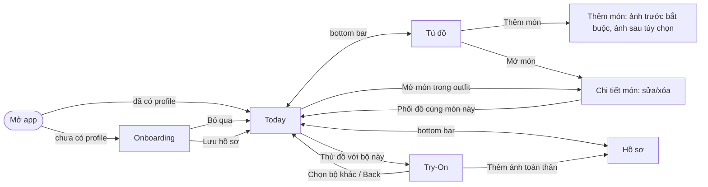

# PRE-006 — Wireflow Profile → Wardrobe → Today → Try-On

[Board](../TASK_BOARD.md) · [Card](D.md#pre-006) · [Contracts](../CONTRACTS.md)

**Owner:** Track D · **Ngày:** 12/11/2026 · **Trạng thái:** viết theo app thật trên `main` (không phải bản vẽ dự kiến). Paper walkthrough với A/B/C vẫn cần làm.

## 1. Bốn route và đường đi

| Route | Code | Owner màn | Entry point |
|---|---|---|---|
| Onboarding / Hồ sơ | `Routes.ONBOARDING`, `Routes.PROFILE` | D (BACK-008, D-005) | `onboardingGraph` |
| Tủ đồ | `Routes.WARDROBE*` | A | `wardrobeGraph` |
| Today | `Routes.TODAY_PATTERN` (`focusItemId` tùy chọn) | D (C-001/C-003) | `todayGraph` |
| Try-On | `Routes.TRYON_PATTERN` (`outfitId`, `snapshotId`) | C (màn), D (route + wiring) | `app/tryon/TryOnDestination.kt` |

## 2. Đường bỏ qua và sửa dữ liệu

- **Mọi field hồ sơ là tùy chọn.** Bỏ qua onboarding vẫn tới Today; phối đồ chỉ cần tủ đồ. Cân nặng và ảnh người **không** gửi cho recommendation (request chỉ có `ProfileProjection`: chiều cao, style, loại đồ ưa thích).
- **Ảnh toàn thân trước/sau độc lập.** Thiếu ảnh sau không bao giờ được thay bằng ảnh trước; Try-On báo thiếu mặt sau.
- **Sửa/xóa món** làm mọi outfit đang hiển thị dùng revision cũ bị ẩn ("Tủ đồ đã thay đổi…"); Mặc/Chia sẻ/Thử đồ trên bộ cũ bị từ chối với `STALE_INPUT`.
- **Sửa hồ sơ / xóa ảnh** đi qua `ProfileStorage` (revision + `invalidations`), có hộp xác nhận.

## 3. Today

1. Chọn dịp (chip) → gọi gợi ý ngay vì là lựa chọn chính.
2. **Tùy chỉnh yêu cầu** (mặc định thu gọn): style override (≤5, để trống = theo hồ sơ), yêu cầu thêm ≤500 ký tự, số bộ 1–5. Sửa các ô này **không** gọi AI; chỉ nút **Gợi ý theo yêu cầu** gửi request.
3. Danh sách 1–5 bộ, mỗi bộ có ảnh món, giải thích, nhãn nguồn: *Gợi ý bởi AI* / *Phối cơ bản* (RULES khi offline/lỗi proxy) / *Dữ liệu thử*.
4. Mỗi bộ: **Mặc bộ này**, **Chia sẻ**, **Thử đồ với bộ này**. Thử đồ chỉ mở màn Try-On cho **đúng một** bộ, không tự tạo job, không chạy cho 5 bộ.
5. **Phối lại** loại các bộ vừa xem (C-102).

## 4. Copy theo trạng thái

| Trạng thái | Nơi | Copy (đang dùng trong app) |
|---|---|---|
| Loading | Today | Spinner, nút Gợi ý tắt khi đang chạy |
| Tủ trống | Today | "Hãy thêm áo và quần/chân váy hoặc một đầm liền vào tủ đồ." + nút Thử lại |
| Bộ cũ sau khi sửa tủ | Today | "Tủ đồ đã thay đổi. Hãy phối lại với các món hiện tại." |
| Ít bộ hơn yêu cầu | Today | "Tủ đồ hiện chỉ có từng này bộ khác nhau." / "Một số lựa chọn đang giới hạn số bộ phù hợp." / "Đã bỏ các bộ có món không hợp lệ." |
| Offline / proxy lỗi | Today | Bộ *Phối cơ bản* (RULES) nếu phối được, nếu không: "Chưa tải được gợi ý. Hãy thử lại." |
| VTO chưa bật (CORE) | Try-On | "Thử đồ ảo chưa được bật trong bản này: nhóm chưa hoàn tất kiểm định chất lượng và quyền riêng tư (C-205)." |
| Consent | Try-On (C-210) | Checkbox gắn với provider, mặc định **tắt**; không consent → 0 upload |
| Một mặt / thiếu mặt sau | Try-On (C-209) | Nhãn mặt trước/mặt sau riêng; không tạo ảnh mặt sau giả |
| Mô phỏng | Try-On | Nhãn *THỬ NGHIỆM*/*FAKE* khi không phải kết quả live đã kiểm chứng; không claim đúng size/độ vừa |

## 5. Phân biệt loại hình ảnh (không được trộn trong pitch)

1. **Collage món đồ** (`OutfitVisual`) — ảnh thật của từng món, không phải ảnh người mặc.
2. **Mô phỏng một mặt** — chỉ khi gate `GO_FRONT_ONLY` + C-212 pass.
3. **Mô phỏng hai mặt** — chỉ khi `GO_DUAL` + C-211.
4. **Ảnh chưa kiểm chứng / FAKE** — chỉ trong Demo Workbench của C, luôn gắn nhãn.

Bản hiện tại là **CORE**: chỉ có (1); (2)–(4) không hiển thị cho người dùng app.
